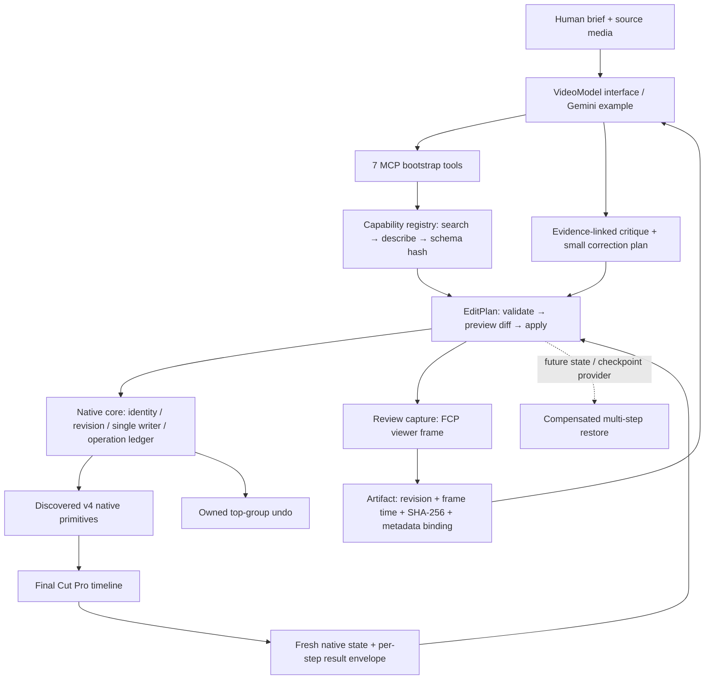

# SpliceKit v4: who calls what

The video model chooses editorial intent. Deterministic Python validates time and
scope. One native adapter owns actual FCP mutation and native readback.

| Component | Responsibility and boundary |
| --- | --- |
| `mcp/server.py` | Select `legacy` / `v4` / `all`; existing legacy behavior defaults unchanged. V4 registers seven tools and performs no startup RPC. |
| `mcp/splicekit_v4/registry.py` | Load every `capabilities/*.json`; reject invalid schemas, external references, duplicates and non-v4 native RPCs; describe build/evidence/undo/readback. |
| `plans.py`, `timing.py` | Ordered typed operations, exact rational clocks, transcript/frame boundaries, source evidence and target scope, sequential application. |
| `runtime.py` | Serialize this Python process, enforce discovery/schema/build gates, validate native envelopes, retain session receipts, stop on UNKNOWN. |
| Native core workstream | Cross-client ownership, durable operation records/idempotency, final target/revision checks inside FCP, observational checkpoints and owned top-group undo. Restorable checkpoint/state providers remain absent. |
| Native editing workstreams | Narrow `v4.<area>.<operation>` RPCs with registered schemas, operation identity and fresh readback. Imported manifests become discoverable without new MCP tools. |
| `review.py` | Use existing `viewer.capture(viewer="normal")`, require native project-viewer identity/render readiness, bound image size with Apple `sips`, verify revision and hash. Native Share video integration is pending. |
| `examples/v4/gemini_edit_loop.py` | Provider-neutral plan/critique interface; one Gemini REST adapter, bounded corrections, dry-run mock. No Claude/OpenAI adapters. |

The integrated registry contains all 49 native methods and four Python plan/review
capabilities. Native plan application/review fail closed on missing restore/source/
viewer state contracts. `examples/v4/fixtures` is an isolated fake
host, never part of the installed registry or evidence of native capability.

Native result contract: `ok`, `operation_id`, `applied`, `readback`,
`revision_before`, `revision_after`, `undo`, `evidence_level`, `warnings`, `error`.
The offline fixture demonstrates known-failure checkpoint compensation; the native
beta rejects that plan before writing. Unknown outcome →
quarantine and native ledger inspection; no automatic retry/backend switch/undo.
Structural readback, visual review, motion, audio, persistence and user acceptance
remain separate facts. See [integration contracts](REGISTRY_CONTRACT.md).
